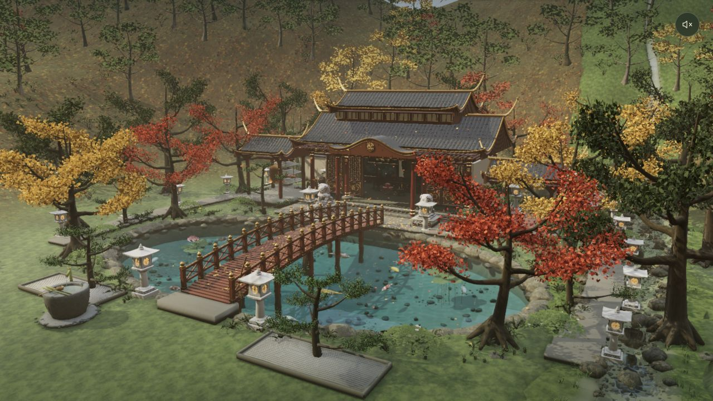

# Chinese Autumn Temple

[English](README.md) · **简体中文**

一座可以在浏览器中参观、做一点小事的秋日山寺。用 Blender 制作场景与模型，用 Three.js 渲染水面、光影和交互。

[在线体验](https://quiet-autumn-temple.lovzoe.chatgpt.site/) · [素材与许可](ASSET_CREDITS.md) · [Blender 工程](docs/blender.md)



## 可以做什么

- 环顾主殿、木桥、池塘与秋日山林，近看荷花、锦鲤和溪水。
- 点击鱼或池水：波纹散开，附近的鱼避让。
- 拿起桥边扫帚，扫去落叶，再放回。
- 拿起入口木勺，搅水、舀水，从侧边倒水，再归还。
- 敲钟，等待余音散去。
- 进入暗殿，逐一点亮四支蜡烛；每次进入重新熄灭。
- 点香、看烟升起，或拿起木鱼逐次敲击。

画面保留音量开关；拿起道具后出现「放回」，进入主殿后出现「返回」。没有漂浮的操作标签。

## 本地运行

需要 Python 3。网页依赖和导出的模型已包含在仓库中，无需 API Key，也不需要重新运行 Blender。

```sh
git clone https://github.com/aicanbuild/chinese-autumn-temple.git
cd chinese-autumn-temple
python3 source/build_browser.py
python3 -m http.server 4188 --bind 127.0.0.1 --directory dist
```

打开 <http://localhost:4188/>。请通过 HTTP 服务打开，不要直接双击 HTML 文件。

如果安装了 Node.js，也可以运行：

```sh
npm run build
npm run dev
npm test
```

方向键前后左右平移，鼠标拖动环顾，滚轮缩放。镜头有限制，避免进入地下。首次加载需要下载较多模型和纹理，建议使用支持 WebGL 2 的桌面浏览器。

## 修改与部署

`dist/*.js` 是可编辑的网页模块；`dist/assets/` 是导出的 GLB、纹理和布局数据。改动后运行 `python3 source/build_browser.py`，刷新浏览器即可。不要编辑 `dist/runtime/`，它由构建脚本生成。

构建后将整个 `dist/` 上传到任意静态网站托管服务。导出的模型和本地 Three.js 依赖也需要一起上传；本站没有后端和账号系统。

`source/` 包含 Blender 建模、导出、材质生成脚本，以及 Node.js 检查和局部 WebGL 对照页。部分建模脚本需要 Release 中的 `.blend` 工程；材质生成脚本可能需要 NumPy、Pillow。详细迭代记录见 [development-notes.md](docs/development-notes.md)。

## 画面与性能

这是一个高细节、风格化的实时网页场景。水面使用反射、折射和程序化波动近似，烟雾与声音也包含程序化效果；它不是完整流体模拟或商业 3A 游戏引擎。模型与纹理较大，设备显卡、窗口分辨率会明显影响加载时间和帧率。欢迎改进纹理复用、按需加载和渲染性能。

检查中的已知限制见 [known-limitations.md](docs/known-limitations.md)。

## 开源许可

项目自有代码使用 [MIT](LICENSE)。第三方模型、材质、环境录音和依赖保留各自许可，尤其石狮模型为 **CC BY 4.0**，使用与再分发时请保留署名及改动说明。完整来源见 [ASSET_CREDITS.md](ASSET_CREDITS.md)。

这是一个借助 AI 辅助开发、Blender 程序化建模及部分生成纹理完成的作品。参考录屏、个人口播、视频剪辑工程和私人部署配置不在开源仓库中。
